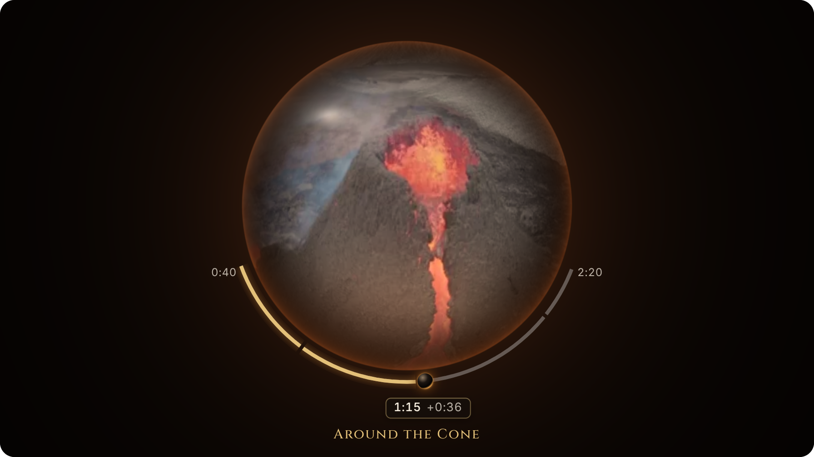
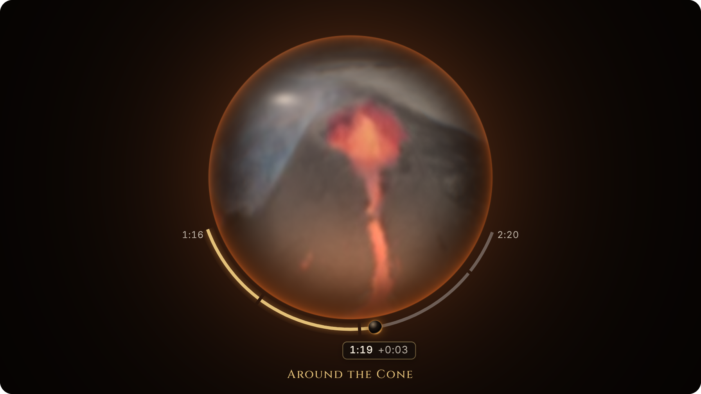
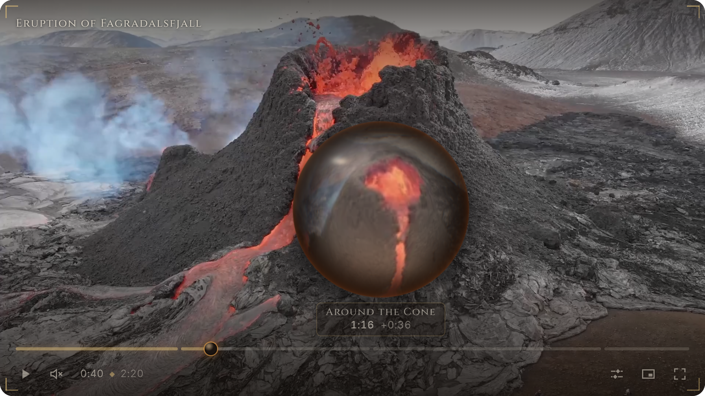

# Scry

A [Video.js v10](https://videojs.org) skin that turns the video into a seeing-stone.

Drag the timeline and the picture rolls up into an orb of dark glass. Inside it the video plays through as you
scrub, instead of flipping between thumbnails, and the timeline bends around the orb's rim. Let go and it opens
on the new frame.



Made by [Ahmed Abuzuraiq](https://abuzreq.com/) for the
[Video.js Skins Design Challenge](https://contra.com/community/topic/videojsskinschallenge/guidelines) on Contra,
November 2026.

## What it does

- **It opens as the stone.** Before the first play the poster frame waits inside an orb, with the play control
  at its centre and embers rising through it. Press play and it opens into the picture.
- **Scrubbing wraps the picture.** Drag the timeline, or drag left and right on the picture itself. The video
  becomes the stone and shows the footage moving as you go.
- **Hovering peeks.** Rest the pointer on the timeline and a small stone shows that moment. The video is left
  alone.
- **Skips pass through the stone.** Arrow keys, number keys, double-click and a click on the timeline all take a
  quick trip through it. Steps shorter than 2.5 seconds cut as usual.
- **Waiting and ending use the same stone.** Buffering fills it with smoke. At the end it holds the opening frame
  with the replay control inside.
- **The rest of the player matches.** Incised icons, titles in Roman capitals, dark tablets with a gold hairline
  for menus and tooltips, a flame for the volume, and four engraved corner marks around the picture.

| Driving time: the fire comes up | Peeking from the timeline |
| --- | --- |
|  |  |

## How it works

Hosts such as Mux publish a storyboard with each video: one image holding a small frame every few seconds, meant
for thumbnail previews. Scry loads that image into a WebGL2 texture and, for each pair of neighbouring frames,
estimates how the picture moves between them (pyramidal Lucas–Kanade optical flow, written as fragment shaders).
While you scrub it uses that motion to warp one frame toward the next and blends them, so a few dozen stills read
as continuous footage. Where two frames have nothing in common, across a cut, it falls back to a dissolve.

The wrap, the lens, the glass, the smoke and the fire are one more shader pass on the same canvas. When the picture
comes to rest, the exact frame is taken from the player (or fetched from Mux) and laid over the storyboard's
approximation, so both ends of a trip are the true picture.

Everything runs on the viewer's device. Nothing is uploaded and, by default, nothing is downloaded beyond the
storyboard the player already uses.

## Run it

```sh
npm install
npm run dev
```

The home page plays the skin. `/workbench.html` opens it in the Video.js workbench, where you can change the
player's size, aspect ratio, text direction and language. `/preview.html` is the player on its own.

To play something else, change the playback ID, poster time and chapters file at the top of
`apps/preview/src/frame/player.ts`. Footage with long, slow takes shows the effect best, and a clip of a couple of
minutes gives a denser storyboard than a long film.

## Use the skin

The skin is the contents of `src/`. Register it, then stamp its template into a player around your media element:

```ts
import '@videojs/html/video/player';
import '@videojs/html/media/mux-video';
import './src/video/skin';
import skin from './src/video/skin.html?raw';

const player = document.createElement('video-player');

player.innerHTML = skin.replace(
  '<!-- Add a compatible media component here. -->',
  '<mux-video src="https://stream.mux.com/PLAYBACK_ID.m3u8" playsinline crossorigin></mux-video>'
);
document.body.append(player);
```

`crossorigin` matters: the stone reads pixels from the storyboard and from the video, which needs CORS headers. Mux
sends them.

### Options

Attributes on `<scry-vision>`, the element inside the skin that draws the stone:

| Attribute | Effect |
| --- | --- |
| `stone="glass"` | Clear crystal and cool white controls instead of the dark seeing-stone. |
| `shape="flat"` | Nothing wraps. The flowing picture plays across the plain rectangle, so the interpolation can be seen on its own. |
| `inspect="compare"` | With `shape="flat"`: a plain crossfade on the left half, the flow-based blend on the right. |
| `inspect="flow"` | With `shape="flat"`: the flow field. Colour is direction, strength is distance. |
| `inspect="agreement"` | With `shape="flat"`: green where the two frames match after warping, red where they do not. |
| `depth="auto"` | Experimental. See below. |

The preview pages take the same names as URL parameters, for example `/preview.html?shape=flat&inspect=flow`.

Captions are drawn by the browser. The skin sets their typeface, colour and background through three custom
properties on the player: `--scry-caption-font`, `--scry-caption-color` and `--scry-caption-plate`.

If a device struggles, lower `ScryVisionElement.maxPixels`, the cap on how many pixels the stone is drawn with.

### Depth (experimental)

`depth="auto"` runs [Depth Anything V2 Small](https://huggingface.co/onnx-community/depth-anything-v2-small) over
the storyboard in a worker and gives the picture inside the stone some parallax. It needs WebGPU
(`depth="wasm"` forces the slower WebAssembly backend) and is the only feature that downloads a model: about 19 MB
on WebGPU, 27 MB on WebAssembly, from the Hugging Face hub, plus the ONNX runtime from jsDelivr. It is off by
default, and if anything fails the picture simply stays flat.

## Accessibility and fallbacks

- Every control is a Video.js component, so roles, labels, keyboard handling and translations are the library's.
  The time slider stays in the document as the real control; the curved bar is a picture of it.
- Tab order follows visual order, and every focusable part has a visible focus ring.
- With reduced motion turned on, without WebGL2, or after a lost graphics context, the stone never appears. The
  player opens on its poster, seeks cut, the timeline preview is a still thumbnail and buffering shows a spinner.
- Without a storyboard the stone still wraps, holding the frame it started from under smoke until the new one
  arrives.
- Forced colours and increased contrast replace glass and gradients with solid surfaces and borders.

## Project layout

```
src/
  video/
    skin.html, skin.ts      the markup, and the elements and icons it registers
    skin.css                structural styles
    scry.css                the shapes
    scry-arc.css            the curved bar
    scry-material.css       what it is all made of
    scry-vision.ts          the element that conducts the stone
    scry-arc.ts             the curved bar
    vision/                 the parts of the stone's behaviour that stand alone:
                            the wrap's state machine, the spring, layout,
                            drag recognition, exact frames, depth, captions
    icons/, fonts/
  liquid/                   the WebGL engine, with no dependency on Video.js:
                            engine, shaders, storyboard parsing, depth worker
  styles/                   theme tokens
apps/preview/               the home page, the workbench and the bare preview
design/                     design notes and screenshots
```

`design/spec.md` describes the design decisions in detail.

## Development

```sh
npm run typecheck   # TypeScript
npm test            # unit tests for the state machine, spring, layout and parsing
npm run build       # production build into dist/
npm run deploy      # deploy dist/ to Vercel, Netlify or Cloudflare Pages
```

`/lab.html` on the dev server renders contact sheets of the interpolation and the wrap, for judging the shaders by
eye.

The project was scaffolded with `videojs skin create` from the Scaffold skin; `skin.json` records the Video.js
version it was made with.

## Credits

- Design and code: [Ahmed Abuzuraiq](https://abuzreq.com/).
- Built on [Video.js v10](https://videojs.org).
- The demo film is the first 2:20 of
  [*Eruption of Fagradalsfjall volcano, 2021-03-24, 2*](https://commons.wikimedia.org/wiki/File:Eruption_of_Fagradalsfjall_volcano,_2021-03-24,_2.webm)
  by Mladen Stojanovic, used under [CC BY 3.0](https://creativecommons.org/licenses/by/3.0/) and shortened. It is
  hosted on [Mux](https://www.mux.com), playback ID `1Xy015xxsJduTP5ZZQFTD7m00D5hLcwslpwppWEPIuYWs`.
- The display typeface is [Cinzel](https://github.com/NDISCOVER/Cinzel) by Natanael Gama, bundled in
  `src/video/fonts/` under the SIL Open Font License 1.1 (`src/video/fonts/OFL.txt`).
- Everything else in the skin, including the icons, is original work.

## Licence

[Apache License 2.0](LICENSE).
